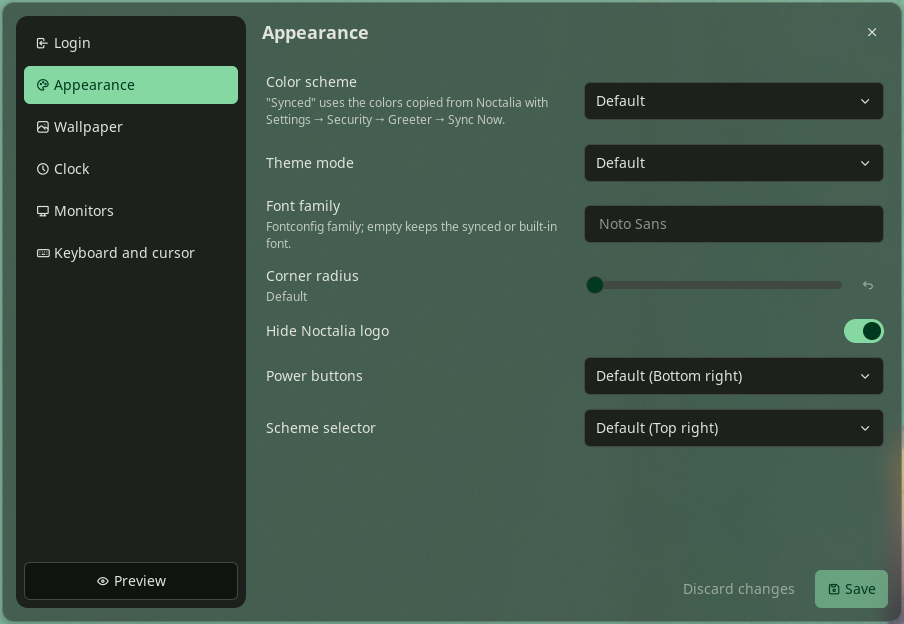

# Greeter Settings for Noctalia

A [Noctalia Shell](https://github.com/noctalia-dev/noctalia) plugin that edits the configuration of
[Noctalia Greeter](https://github.com/noctalia-dev/noctalia-greeter) from a panel: default session and
user, color scheme and appearance, wallpaper, clock, monitors, keyboard and cursor. A nested preview
shows the login screen with the unsaved changes.



The panel follows the layout of Noctalia's settings window: a sidebar with six sections (Login,
Appearance, Wallpaper, Clock, Monitors, Keyboard and cursor) and one row per setting, with the name and
a short explanation on the left and the control on the right. Every menu starts with **Default**, which
names the greeter's built-in value where it is known (for example *Default (Bottom right)*).

Noctalia Shell itself only offers **Sync Now** (wallpaper, palette, font, monitor layout). Everything
else lives in `greeter.toml`, which normally needs a text editor and root.

| | |
| --- | --- |
| Plugin id | `kabronius/greeter-settings` |
| Entries | panel `panel`, bar widget `bar` |
| Plugin API | 27 (Noctalia Shell 5.0.1 or newer) |
| Edits | `/var/lib/noctalia-greeter/greeter.toml` |
| License | Apache-2.0 |

## Installation

```sh
git clone https://github.com/kabronius/noctalia-greeter-plugin.git ~/src/noctalia-greeter-plugin
ln -s ~/src/noctalia-greeter-plugin ~/.local/share/noctalia/plugins/greeter-settings
noctalia msg plugins enable kabronius/greeter-settings
```

Open the panel with the bar widget (**Settings → Bar → Add widget → Greeter Settings**) or:

```sh
noctalia msg panel-toggle kabronius/greeter-settings:panel
```

Requirements: Noctalia Greeter installed, Python 3.11 or newer (`tomllib`), and a Polkit
authentication agent for `pkexec` (Noctalia's own: **Settings → Security → Polkit Agent**).

### Preview window size

The preview is a nested wlroots compositor; it appears as an ordinary window with app id `wlroots`
and asks for a 1280×720 output. A tiling compositor places it like any new window, so on niri it opens
as a narrow column next to the others, and a floating 1280×720 window does not fit a portrait monitor.
A full-width column fits every monitor and looks like the real login screen. On niri:

```kdl
// Noctalia Greeter preview (Greeter Settings plugin): the nested wlroots compositor.
window-rule {
  match app-id="^wlroots$"
  default-column-width { proportion 1.0; }
  open-focused true
}
```

The rule matches every nested wlroots compositor, not only the preview.

## Plugin settings

| Key | Default | Purpose |
| --- | --- | --- |
| `greeter_bin_dir` | `/opt/noctalia-greeter/bin` | Directory with `noctalia-greeter` and `noctalia-greeter-compositor`; `/usr/bin` for distribution packages |
| `state_dir` | `/var/lib/noctalia-greeter` | Directory holding `greeter.toml` |
| `privilege_command` | `pkexec` | Command prefix for the import and install steps, split on spaces (for example `run0`) |

## IPC

The open panel accepts commands, useful for scripts:

```sh
P=kabronius/greeter-settings:panel
noctalia msg plugin $P all section clock                   # login, appearance, wallpaper, clock, outputs, input
noctalia msg plugin $P all import
noctalia msg plugin $P all set clock.position=top-center   # "key=" removes the key
noctalia msg plugin $P all set appearance.hide_logo=true
noctalia msg plugin $P all save
noctalia msg plugin $P all preview                         # again to close it
noctalia msg plugin $P all revert
```

`true`/`false` and numbers keep their TOML type; anything else is written as a string.

## Tests

`tests/greeter_toml_test.luau` covers reading, replacing, removing and adding keys, preservation of
comments and unmanaged sections, blank-line layout, string escaping and byte-identical no-op edits. It
needs a Luau interpreter whose `require` resolves paths relative to the requiring file; the edited
document it prints last can be checked with `python3 -c "import tomllib, sys; tomllib.load(sys.stdin.buffer)"`.

## Verification status

Checked with Noctalia Shell 5.0.1 and Noctalia Greeter 1.7.0 on Ubuntu 24.04:

- module tests: 20/20;
- panel loads, lists sessions, users, outputs and cursor themes, and renders imported values in all
  six sections;
- import of the installed `/var/lib/noctalia-greeter/greeter.toml` through `pkexec` and the Noctalia
  Polkit agent;
- import, edit and save through IPC against a test state directory (`privilege_command = env`): keys
  replaced, removed and added, palette and comments preserved, `greeter.toml.bak` kept, result valid
  TOML with mode `0640`;
- preview window reflects unsaved changes (clock position, hidden logo, default session) and closes
  on the second request.
- with the niri rule above, the preview fills a 1080×1920 portrait monitor as a single column.

Not exercised: a save into `/var/lib/noctalia-greeter` through `pkexec` (the install step was tested
with `privilege_command = env` only), and the current-wallpaper button.
