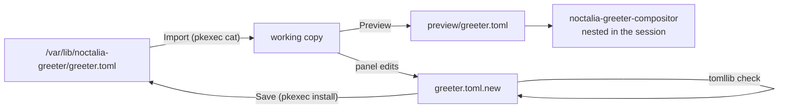

# Greeter Settings for Noctalia

A [Noctalia Shell](https://github.com/noctalia-dev/noctalia) plugin that edits the configuration of
[Noctalia Greeter](https://github.com/noctalia-dev/noctalia-greeter) from a panel: default session and
user, color scheme and appearance, wallpaper, clock, monitors, keyboard and cursor. A nested preview
shows the login screen with the unsaved changes.

Noctalia Shell itself only offers **Sync Now** (wallpaper, palette, font, monitor layout). Everything
else lives in `greeter.toml`, which normally needs a text editor and root.

| | |
| --- | --- |
| Plugin id | `kabronius/greeter-settings` |
| Entries | panel `panel`, bar widget `bar` |
| Plugin API | 27 (Noctalia Shell 5.0.1 or newer) |
| Edits | `/var/lib/noctalia-greeter/greeter.toml` |
| License | Apache-2.0 |

## How it works

`/var/lib/noctalia-greeter` belongs to greetd's session user (`_greetd` on Ubuntu, `greeter` on most
other distributions) and is not readable by the desktop user. The panel therefore works on a copy in
the plugin data directory (`~/.local/state/noctalia/plugins/data/kabronius/greeter-settings/`).



| Step | What happens |
| --- | --- |
| Import | One privileged `cat` of the installed file. Until then the controls stay disabled, so a save can never overwrite a file the panel has not read. |
| Edit | Each control maps to one `key = value` line. **Default** removes the key, so the greeter's built-in default applies. |
| Save | The copy is rewritten, parsed with Python's `tomllib` (a malformed file never reaches the login screen), then one privileged shell installs it with the state directory's owner and mode `0640`, keeping the previous file as `greeter.toml.bak`. |
| Wallpaper | greetd's user cannot read `$HOME`, so an image outside the state directory is copied there as `wallpaper-custom.<ext>` during the same save. |
| Preview | Writes the unsaved settings to a temporary directory and runs `noctalia-greeter-compositor` as a window in the current Wayland session with `NOCTALIA_GREETER_STATE_DIR` pointing there. It cannot log in (no greetd socket) and does not see the synced palette or wallpaper. |

### What the panel changes in `greeter.toml`

`greeter_toml.luau` edits the file line by line. It reads and writes only `key = scalar` lines in the
sections below; comments, `[appearance.palette]`, per-output wallpapers, inline tables and any other
key are written back unchanged. Managed sections left without keys are removed, and section headers
are separated by one blank line.

| Section | Keys |
| --- | --- |
| `[session]`, `[user]` | `default` (lists from `noctalia-greeter sessions` and `/etc/passwd`, UID 1000–59999 with a login shell) |
| `[appearance]` | `scheme`, `theme_mode`, `password_style`, `hide_logo`, `power_buttons_position`, `scheme_selector_position`, `font_family`, `corner_radius_scale` |
| `[appearance.wallpaper]` | `path`, `fill_mode`, `fill_color` |
| `[clock]` | `enabled`, `position`, `time_format`, `date_format` |
| `[output]` | `name` (list from `noctalia-greeter outputs`) |
| `[idle]` | `timeout` |
| `[cursor]` | `theme` (themes with a `cursors/` directory), `size` |
| `[keyboard]` | `layout`, `variant`, `numlock` |

A value the lists do not contain, for example one written by hand, is shown as an extra entry instead
of being dropped. Keys for multi-monitor layout, scales, transforms, refresh rate and authentication
are left to hand editing; see the greeter's
[configuration reference](https://docs.noctalia.dev/greeter/configuration/).

Settings take effect the next time the login screen starts. Output, keyboard, cursor and idle settings
are read by the compositor, so they need a greetd restart, which also ends the running session; a
reboot or logout is the usual way.

## Installation

```sh
git clone https://github.com/kabronius/noctalia-greeter-plugin.git ~/src/noctalia-greeter-plugin
ln -s ~/src/noctalia-greeter-plugin ~/.local/share/noctalia/plugins/greeter-settings
noctalia msg plugins enable kabronius/greeter-settings
```

Open the panel with the bar widget (**Settings → Bar → Add widget → Greeter Settings**) or:

```sh
noctalia msg panel-toggle kabronius/greeter-settings:panel
```

Requirements: Noctalia Greeter installed, Python 3.11 or newer (`tomllib`), and a Polkit
authentication agent for `pkexec` (Noctalia's own: **Settings → Security → Polkit Agent**).

## Plugin settings

| Key | Default | Purpose |
| --- | --- | --- |
| `greeter_bin_dir` | `/opt/noctalia-greeter/bin` | Directory with `noctalia-greeter` and `noctalia-greeter-compositor`; `/usr/bin` for distribution packages |
| `state_dir` | `/var/lib/noctalia-greeter` | Directory holding `greeter.toml` |
| `privilege_command` | `pkexec` | Command prefix for the import and install steps, split on spaces (for example `run0`) |

## IPC

The open panel accepts commands, useful for scripts:

```sh
P=kabronius/greeter-settings:panel
noctalia msg plugin $P all import
noctalia msg plugin $P all set clock.position=top-center   # "key=" removes the key
noctalia msg plugin $P all set appearance.hide_logo=true
noctalia msg plugin $P all save
noctalia msg plugin $P all preview                         # again to close it
noctalia msg plugin $P all revert
```

`true`/`false` and numbers keep their TOML type; anything else is written as a string.

## Tests

`tests/greeter_toml_test.luau` covers reading, replacing, removing and adding keys, preservation of
comments and unmanaged sections, blank-line layout, string escaping and byte-identical no-op edits. It
needs a Luau interpreter whose `require` resolves paths relative to the requiring file; the edited
document it prints last can be checked with `python3 -c "import tomllib, sys; tomllib.load(sys.stdin.buffer)"`.

## Verification status

Checked with Noctalia Shell 5.0.1 and Noctalia Greeter 1.7.0 on Ubuntu 24.04:

- module tests: 20/20;
- panel loads, lists sessions, users, outputs and cursor themes, and renders imported values;
- import, edit and save through IPC against a test state directory (`privilege_command = env`): keys
  replaced, removed and added, palette and comments preserved, `greeter.toml.bak` kept, result valid
  TOML with mode `0640`;
- preview window reflects unsaved changes (clock position, hidden logo, default session) and closes
  on the second request.

Not exercised against `/var/lib/noctalia-greeter` with `pkexec` in this test run: that path differs
only by the privilege prefix.
